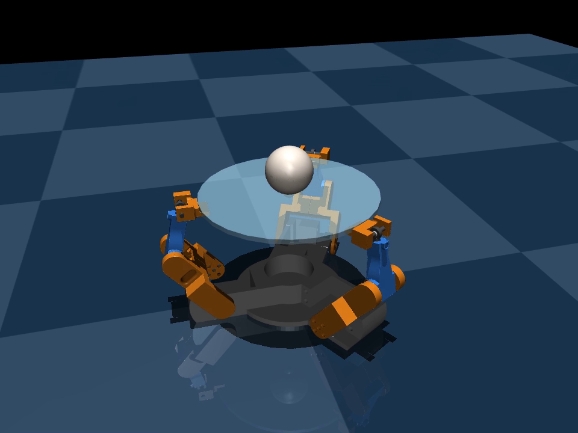
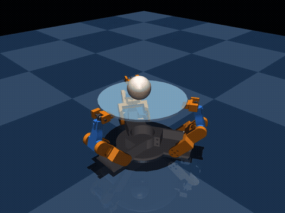

# Ball Holder

A 3-servo parallel platform that keeps a ball balanced on a glass plate. The
controller is a **TD3** reinforcement-learning agent trained in a **MuJoCo**
simulation built from the CAD model.

<!-- Replace with a photo of the real build: save it as media/photo.jpg -->
| Real build | Simulation |
|:---:|:---:|
| _Photo coming soon: add `media/photo.jpg` and swap this text for_ `` |  |

## Demo

The trained policy balancing the ball in MuJoCo, with random kicks to the ball:



Full video (3 episodes, 15 s): [media/ball_holder_sim.mp4](media/ball_holder_sim.mp4)

## How it works

- **Hardware:** three servo-driven arms (upper arm + forearm with a ball joint)
  hold a 152 mm glass plate. Tilting the plate rolls the ball.
- **Inverse kinematics:** `BallEnv.set_servo_angles` turns a desired plate
  roll/pitch into three servo angles using the law of cosines on each arm.
- **Environment:** each step the agent picks a roll and pitch (each up to
  $\pm 8^\circ$). The observation is 10 numbers: ball position $(x,y,z)$,
  ball velocity, ball height above the plate, and the 3 servo targets.
  The ball gets a random kick at the start and occasionally during an episode.
- **Reward:** per step,
  $r = 0.2 + 0.7\left(1 - \frac{d}{R}\right) - 0.1\lVert\Delta u\rVert^2$,
  where $d$ is the ball's distance from the plate center, $R$ the plate
  radius, and $\Delta u$ the change in servo commands. The episode ends if
  the ball falls off, or after 250 steps (5 s).
- **Agent:** TD3 with twin critics, target policy smoothing, and delayed
  actor updates. Actor and critics are small MLPs (64 → 50, LayerNorm,
  LeakyReLU).

## Repo layout

| Path | What it is |
|---|---|
| `ball_balancer.xml` | MuJoCo model of the platform, arms, and ball |
| `BallEnv.py` | Environment: IK, reset, step, reward |
| `agent.py`, `networks.py`, `replaybuffer.py` | TD3 agent |
| `main.py` | Training loop (logs to TensorBoard in `runs/`) |
| `watch.py` | Opens the MuJoCo viewer and runs the trained policy |
| `record_video.py` | Renders the trained policy to an mp4, headless |
| `td3/ball_holder/` | Trained weights (loaded by default) |
| `td3/ball_holder_v1/` | Earlier checkpoint |
| `Make_urdf_description/meshes/` | **STL files** for every part |
| `Make_urdf_description/` | URDF / ROS package exported from Fusion 360 |
| `setup_adroit.sh`, `job*.slurm` | Setup and training on the Adroit HPC cluster |
| `media/` | Photos and videos for this README |

## Quick start

```bash
pip install torch
pip install -r requirements.txt

python watch.py          # watch the trained policy in the MuJoCo viewer
python main.py           # train (resumes from td3/ball_holder if present)
tensorboard --logdir runs
python record_video.py   # save media/ball_holder_sim.mp4
```

Run commands from the repo root so the model and mesh paths resolve.

## Training on a cluster

```bash
bash setup_adroit.sh     # once, on the login node
sbatch job_test.slurm    # ~1 min smoke test
sbatch job.slurm         # full run
```
